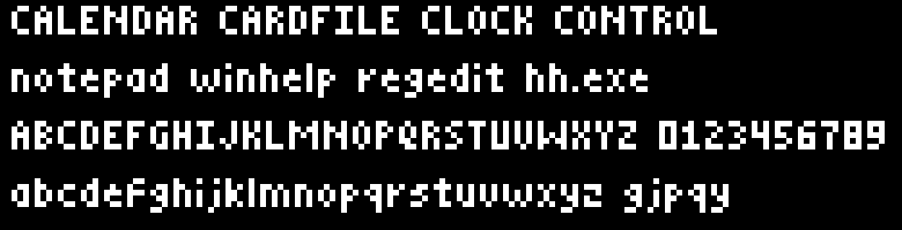
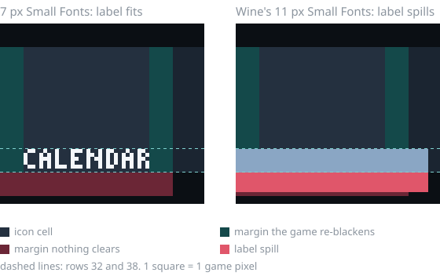

# Operation: Inner Space trail fix for Wine

If you run **Operation: Inner Space** (Software Dynamics, 1994) under Wine and
moving icons leave dotted, hatched trails behind them, the cause is a missing
font size. This repo provides that font: a 7-pixel *Small Fonts* bitmap face.
Installing it fixes the trails, and the game itself stays unmodified.

**Short version.** The game labels icons with *Small Fonts* at 7 pixels. Wine's
replacement Small Fonts only contains an 11-pixel face, so the labels overflow
into a strip of the sprite sheet that the game copies onto the screen whenever
an icon moves. Install a 7-pixel Small Fonts face, **register it**, and the
trails are gone.

## Quick fix

Download or clone this repository, then point the install script at the Wine
prefix the game runs in:

```sh
WINEPREFIX=~/path/to/your/prefix ./install.sh
```

That's all. Start the game as usual. To do the same by hand:

```sh
cp SMALL7.FON "$WINEPREFIX/drive_c/windows/Fonts/"
wine reg add 'HKLM\Software\Microsoft\Windows NT\CurrentVersion\Fonts' \
    /v 'Small Fonts 7px' /t REG_SZ /d SMALL7.FON /f
wineserver -k
```

**The registry step is required.** Wine skips `.fon` files when it scans the
Fonts folder and only loads bitmap fonts that are listed in the registry. The
value name can be anything except exactly `Small Fonts`, because Wine skips an
entry whose name matches a face it already has.

`SMALL7.FON` is built by `small7font.py` (Python 3, no dependencies). If you'd
rather not trust a binary file, delete it and rebuild it; the build is
byte-for-byte reproducible:

```sh
python3 small7font.py SMALL7.FON
```



## What you see

Icons you chase leave chains of small white dashes or hatching along their
path. It happens mostly while your ship is moving, only some icons do it, and
anything that flies over a trail wipes it away. Ships, asteroids and fuel pods
are unaffected. The same game under real Windows 3.1 (for example inside
DOSBox) shows no trails at all, which makes it look like an emulator bug. It is
not.

## Why it happens

The game keeps every icon on a sprite sheet: a 32×32 cell with a 6-pixel black
margin around it. It writes the program's name inside the bottom of the cell,
centred, starting at row 32, then re-blackens the left and right margins. It
never touches the bottom margin. That layout only works if the label fits in
rows 32–37.

To move an icon a few pixels, the game does not erase it. It copies a slightly
larger rectangle from the sheet (the cell plus part of its margin) and relies
on that margin being black. Whatever sits in the margin gets painted behind the
icon, once per frame.



With a 7-pixel face, `CALENDAR` is 33 px wide and its ink ends at row 37. With
Wine's 11-pixel face the same label is 53 px wide and 11 rows tall: rows 38–42
land in the bottom margin, which nothing ever clears, and the right end reaches
the next icon's cell.

The exact request, read from the game's code, is:

```c
CreateFont(7, 0, 0, 0, 0, 0, 0, 0, ANSI_CHARSET, 0, 0,
           PROOF_QUALITY, VARIABLE_PITCH | FF_SWISS, "Small Fonts");
```

`PROOF_QUALITY` asks for an unscaled bitmap face, so with only an 11-pixel face
available, the game gets 11 pixels.

A genuine Windows 3.1 `SMALLE.FON` also contains a 7-pixel face and should work
the same way if you install it under a new name (for example `SMALLE31.FON`, so
it doesn't clash with Wine's own `smalle.fon`). That route has not been tested.

## Check what Wine hands the game

`fonttest.c` makes the game's exact font request and prints the result. Build
it with the mingw cross-compiler and run it in the game's prefix:

```sh
i686-w64-mingw32-gcc -O2 -o fonttest.exe fonttest.c -lgdi32
wine fonttest.exe
```

On a fresh 32-bit Wine 11.17 prefix, before and after `install.sh`:

```
before: height 11  ascent 9  "CALENDAR" extent: 53 x 11 px  rows 32..42
after:  height 7   ascent 5  "CALENDAR" extent: 33 x 7 px   rows 32..38 (row 38 is blank)
```

## Don't patch the game

It is tempting to change the game's erase logic instead, so moving sprites
always clear their old position. That does remove the trails, but the
death-screen fireworks rely on the same copy-from-the-margin trick and stop
rendering properly. The font fix leaves the game's code alone, so every effect
keeps working as designed.

## Other problems you're likely to hit

**The game won't start at all.** 16-bit Windows programs need a 32-bit
(non-WoW64) Wine build or [otvdm](https://github.com/otya128/winevdm). Current
distribution Wine packages are often WoW64-only and cannot run Win16 code, even
though they ship `krnl386.exe16`. A portable 32-bit build such as
[Kron4ek's](https://github.com/Kron4ek/Wine-Builds) `wine-x.y-x86` works.

**The window collapses to a small black rectangle.** The game opens a
fullscreen popup at your desktop resolution, and some window managers (KDE
Plasma on a 4K screen, for one) keep resizing it. Run it in a Wine virtual
desktop:

```sh
wine explorer /desktop=InnerSpace,1920x1080 'C:\SPACE\INSPACE.EXE'
```

**On a 4K screen the game only fills a corner.** Under Wayland, X11 apps often
receive raw physical pixels, so a 1920×1080 desktop covers a quarter of a
3840×2160 panel. Running the same command inside
[gamescope](https://github.com/ValveSoftware/gamescope) enlarges it by exactly
2× with nearest-neighbour filtering, which keeps the pixel art sharp:

```sh
gamescope -w 1920 -h 1080 -W 3840 -H 2160 -f -S integer -F nearest -- \
    wine explorer /desktop=InnerSpace,1920x1080 'C:\SPACE\INSPACE.EXE'
```

**No music, or a freeze when entering a folder.** The soundtrack is MIDI.
Without a synthesizer, Wine sends it to a silent ALSA port, and a track change
can deadlock (the game waits forever for Wine's MIDI sequencer to close). Run
FluidSynth with a General MIDI soundfont and point Wine's MIDI mapper at it:

```sh
sleep infinity | fluidsynth -q -a pipewire -m alsa_seq -o midi.portname=InnerSpace \
    /usr/share/soundfonts/FluidR3_GM.sf2 &
wine reg add 'HKCU\Software\Microsoft\Windows\CurrentVersion\Multimedia\MIDIMap' \
    /v CurrentInstrument /t REG_SZ /d 'InnerSpace - InnerSpace' /f
```

FluidSynth 2.6 names the whole client after `midi.portname`, and Wine lists it
as "client - port", hence the doubled name.

**The game says LIMITED after you copied it.** The registration is tied to the
environment it was installed in. Run the game's own installer inside the prefix
you will play in; don't copy an installed `SPACE` folder from somewhere else.

**The installer can't find its files on D:.** Wine assigns D: to your optical
drive and silently replaces a manual D: mapping. Map the install files to an
unused letter such as M: instead.

**Installing the ship sets.** Each add-on set includes its own `SETUP.EXE`. Its
`INSTALL.INI` lists every file with a destination code: `0` is the game folder,
`1` is `SHIPS`, `2` is `SOUNDS`.

## Tested on

| | |
|---|---|
| Game | Operation: Inner Space Plus Edition 1.29.08, with the Military, Nations and The Works ship sets |
| Runtime | Wine 11.17, 32-bit build, game run with Wine's built-in Win16 support (**tested**) |
| Fresh prefix | `install.sh` on a brand-new 32-bit Wine 11.17 prefix, checked with `fonttest` (**tested**) |
| otvdm on Wine | Shows the same trails, because otvdm draws through Wine's GDI. The font fix should apply unchanged (not tested) |
| Windows | Not tried. Windows includes its own Small Fonts, so the problem may never appear there |
| Desktop | KDE Plasma on Wayland (Xwayland), 4K display at 1.7× scale, filled pixel-exact by gamescope 3.16 (**tested**) |

## Files

| File | What it is |
|---|---|
| `SMALL7.FON` | The font: one 7-pixel *Small Fonts* face, hand-drawn, about 3 KB |
| `small7font.py` | Builds `SMALL7.FON` from the glyph table in the script |
| `install.sh` | Copies the font into `$WINEPREFIX` and registers it |
| `fonttest.c` | Prints the font Wine returns for the game's exact request |

## License

MIT, see [LICENSE](LICENSE). The glyphs were drawn from scratch for this
project; no Microsoft font data is included. Operation: Inner Space is not
included and is the property of its owners.
